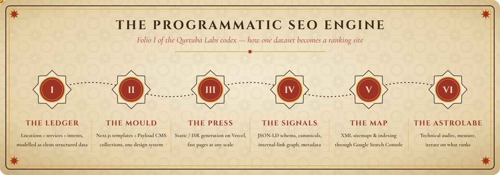

<!-- ═══════════════════════  QURTUBA LABS · profile of Muhammad Bangash  ═══════════════════════ -->

<div align="center">



<a href="https://git.io/typing-svg"></a>

<a href="https://www.codinito.com"></a> <a href="https://linkedin.com/in/muhammad-bangash-24b241224"></a>  

</div>

<br/>

> **Qurtuba, 10th century.** The library of al-Hakam II held a city's worth of knowledge, copied, catalogued and cross-referenced by hand.
> **Qurtuba Labs, today.** Same discipline, different medium: I engineer web platforms end to end, then I make search engines find every page of them.

I'm **Muhammad Bangash**: a full-stack engineer and **programmatic SEO** specialist. I take a product from schema to server to the search results page. I run **[Codinito](https://www.codinito.com)**, where we build Next.js sites, wire them to Payload CMS, deploy them on Vercel, and grow them with page systems built to rank. One engineer, no handoffs, no gaps.


## ✦ What I build &nbsp;·&nbsp; <sub>الصَّنعة · the craft</sub>

| | |
|---|---|
| 🏛️ **Production web platforms** | Next.js & React frontends on TypeScript, Node/NestJS APIs, PostgreSQL / MongoDB data layers. Designed, built and deployed by one pair of hands. |
| 📜 **Headless CMS builds** | Payload CMS (and Sanity) integrations so marketing teams publish without touching code, and developers keep full control. |
| 🗺️ **Programmatic SEO page systems** | Hundreds of location × service pages from one dataset, each with its own schema, canonical and metadata, all generated, sitemapped and indexed. |
| 🔭 **Technical SEO audits** | Crawlability, indexation, canonicals, structured data, Core Web Vitals, Search Console diagnostics. I find the leaks and fix them in code. |
| ✉️ **Cold-email & lead-gen automation** | Outbound pipelines that find, enrich and reach the right prospects, so the site's traffic has a sales engine behind it. |
| ▲ **Deployment & DevOps** | Vercel, AWS, Docker and GitHub Actions. Branch previews, CI pipelines and clean releases. |


## ✦ Programmatic SEO &nbsp;·&nbsp; <sub>الخِزانة · the library</sub>

Al-Hakam's librarians didn't write one book at a time. They ran a system. That's how I treat search: **a single source of truth, a template that is good enough to multiply, and every technical signal handled so Google trusts all of it.**

<div align="center">

</div>

- **Data modelling first:** locations, services and intents as structured collections, not copy-pasted pages.
- **Templates that deserve to scale:** unique, useful content blocks per page so you don't ship thin duplicates.
- **Every signal wired in code:** JSON-LD schema (e.g. `LocalBusiness`, `Service`, `FAQPage`, `BreadcrumbList`), self-referencing canonicals, metadata and internal-link graphs.
- **Discovery engineered:** segmented XML sitemaps, clean robots rules, indexing monitored in Google Search Console.
- **Measured, not guessed:** audits → fixes → re-crawl → iterate on what actually ranks.

<!-- ✍️ PLACEHOLDER (optional): add a real, verifiable pSEO result here, e.g. "<client/site> — <N> pages indexed, <metric> in <timeframe>". Leave it out if you can't link or prove it. -->


## ✦ Tech arsenal &nbsp;·&nbsp; <sub>الأدوات · the instruments</sub>

<div align="center">

**The forge: frontend**<br/>
<br/>    

**The engine room: backend & data**<br/>
<br/>    

**The scriptorium: CMS & content**<br/>
 

**The observatory: SEO instruments**<br/>
   

**The caravan: cloud & DevOps**<br/>


**The apprentices: AI tooling**<br/>
  

</div>


## ✦ Selected work &nbsp;·&nbsp; <sub>الأعمال · from the archive</sub>

<div align="center">

<a href="https://github.com/MuhammadDev-OP/crypto-tracker"></a> <a href="https://github.com/MuhammadDev-OP/jotion-app"></a> <a href="https://github.com/MuhammadDev-OP/url-shortner"></a> <a href="https://github.com/MuhammadDev-OP/ecom-web"></a>

</div>

| Project | What it is | Built with | Live |
|---|---|---|---|
| [**crypto-tracker**](https://github.com/MuhammadDev-OP/crypto-tracker) | Cryptocurrency price dashboard with spark-line charts | Next.js 14 (App Router), Bun, TanStack Query v5, Recharts, Tailwind | [live ↗](https://crypto-tracker-xi-drab.vercel.app/) |
| [**jotion-app**](https://github.com/MuhammadDev-OP/jotion-app) | Document workspace app | Next.js, Convex, Clerk auth, Radix UI, cmdk | [live ↗](https://jotion-app-psi.vercel.app) |
| [**url-shortner**](https://github.com/MuhammadDev-OP/url-shortner) | URL shortening service with redirects and caching | Node.js, Express, MongoDB, Redis (Upstash) | n/a |
| [**weather-app**](https://github.com/MuhammadDev-OP/weather-app) | Weather mapping & analysis over North Africa | Next.js, MapTiler Weather, MapLibre GL, ApexCharts | [live ↗](https://weather-app-delta-ashy.vercel.app) |
| [**my-atlanta-pc**](https://github.com/MuhammadDev-OP/my-atlanta-pc) | Full-stack hotel & resort reservation system | Next.js, NextAuth, Prisma, Leaflet maps, Cloudinary | n/a |
| [**ecom-web**](https://github.com/MuhammadDev-OP/ecom-web) | E-commerce site with a headless CMS | Next.js 13, Sanity, Drizzle ORM, Vercel Postgres | n/a |
| [**ngage-esports**](https://github.com/MuhammadDev-OP/ngage-esports) | Esports web platform | Next.js, Prisma, Zustand, React Hook Form | [live ↗](https://ngage-esports.vercel.app) |
| [**rehouse-personal**](https://github.com/MuhammadDev-OP/rehouse-personal) | Animated marketing site with CMS content | Next.js, Sanity, GSAP, Embla Carousel | [live ↗](https://rehouse-phi.vercel.app) |
| [**ai-audio-recognition-py**](https://github.com/MuhammadDev-OP/ai-audio-recognition-py) | Speech recognition with a KNN classifier | Python, scikit-learn | n/a |

<sub>Most client and agency work (Codinito builds, pSEO systems, automation) lives in private repositories.</sub>

<!-- ✍️ PLACEHOLDER: add 2–3 public client sites / case studies from codinito.com here (name · one line · link). Only ones you're allowed to show. -->


## ✦ The ledger &nbsp;·&nbsp; <sub>السِّجِلّ · live stats</sub>

<div align="center">

 


</div>


## ✦ Summon the lab &nbsp;·&nbsp; <sub>المُراسَلة · correspondence</sub>

```ts
const muhammad = {
  title:   "Full-Stack Engineer · Programmatic SEO Architect",
  atelier: "Qurtuba Labs",
  agency:  "https://www.codinito.com",
  stack:   ["Next.js", "React", "TypeScript", "Node.js", "NestJS"],
  cms:     ["Payload CMS", "Sanity"],
  data:    ["PostgreSQL", "Neon", "MongoDB", "Redis", "Prisma", "Drizzle"],
  cloud:   ["Vercel", "AWS", "Docker", "GitHub Actions"],
  seo:     ["programmatic pages", "JSON-LD", "canonicals", "sitemaps", "Search Console"],
  growth:  ["cold-email systems", "lead-gen automation"],
  status:  "open to serious builds",
};
```

<div align="center">

<a href="https://www.codinito.com"></a> <a href="https://linkedin.com/in/muhammad-bangash-24b241224"></a> 

<!-- ✍️ OPTIONAL: Codinito's own site also lists these. Uncomment if you want them here.
<a href="https://www.linkedin.com/company/codinito"></a> <a href="https://www.instagram.com/codinito.soft"></a>
-->

<br/><br/>


<sub><i>Arches after the Great Mosque of Córdoba · geometry after the zellige masters · built with code, not costume.</i></sub>

</div>
